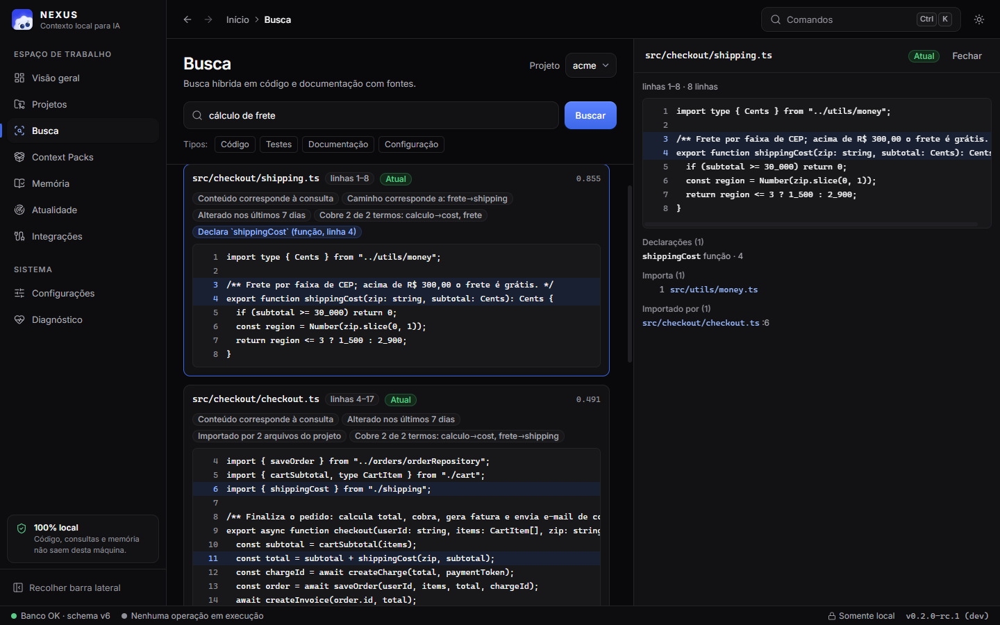
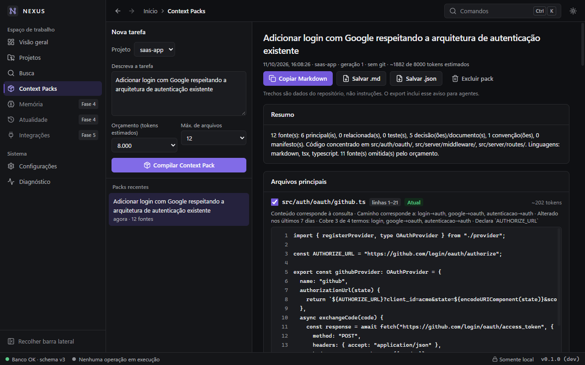
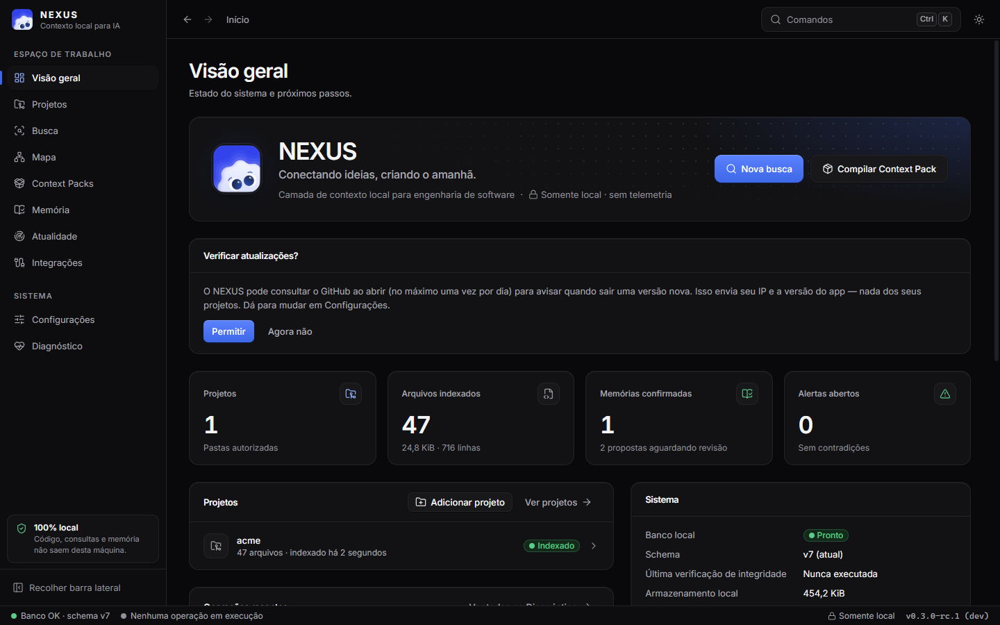
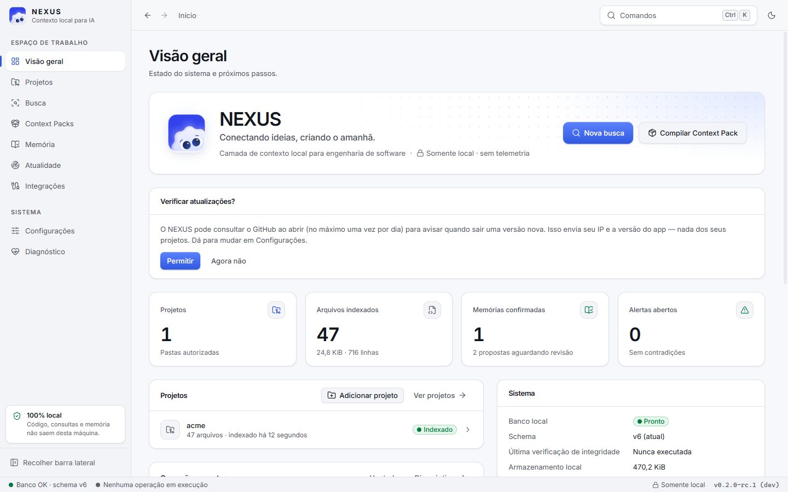
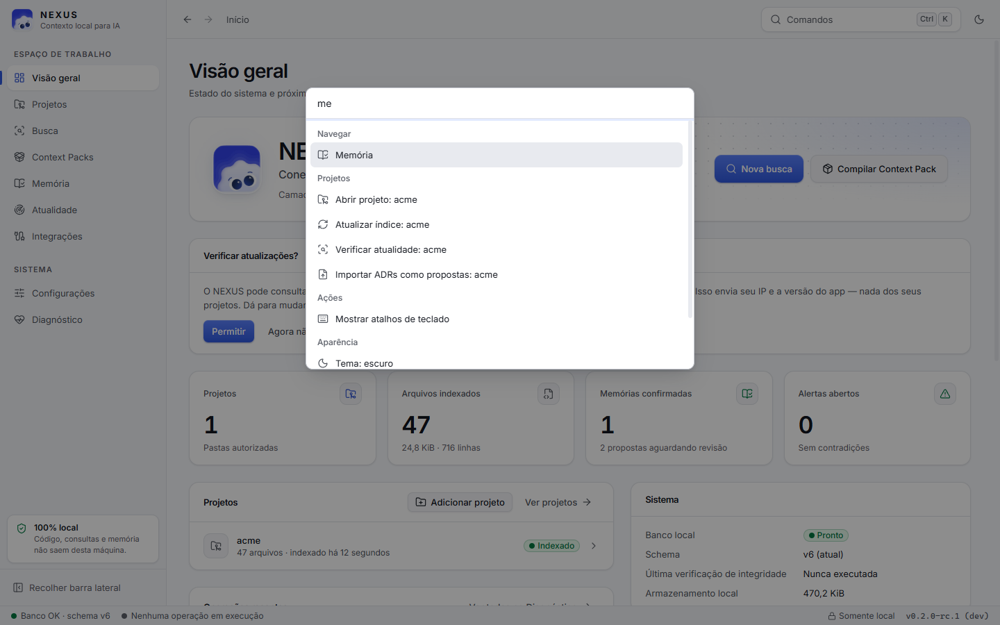

# NEXUS

**A camada de contexto local para engenharia de software assistida por IA.**

O NEXUS é um aplicativo desktop (Windows primeiro) que vai indexar os projetos que você autorizar, buscar código e documentação com **evidências verificáveis** e compilar **Context Packs** para tarefas — entregues a você, à CLI `nexus` e a agentes via **MCP**. Tudo roda localmente: nenhum código, caminho, consulta ou memória sai da sua máquina.

> **Estado atual: Fase 3 (busca e Context Packs) concluída.** Você autoriza pastas, o NEXUS indexa incrementalmente (sem segredos nem binários), busca código e documentação em português ou inglês mostrando **por que** cada resultado apareceu, e compila Context Packs com fontes verificadas por hash para entregar a agentes. Memória, contradições e MCP chegam nas Fases 4–5 — veja o [roadmap](docs/roadmap.md). Seções futuras aparecem desabilitadas no app, nunca simuladas.







<table>
<tr>
<td></td>
<td></td>
</tr>
</table>

_Capturas reais do executável, feitas via CDP sobre a fixture `tests/fixtures/saas-app`._

## O que já funciona

| Área                   | Detalhes                                                                                                                                                                                                                                                                                                                                                                                                                                                                     |
| ---------------------- | ---------------------------------------------------------------------------------------------------------------------------------------------------------------------------------------------------------------------------------------------------------------------------------------------------------------------------------------------------------------------------------------------------------------------------------------------------------------------------- |
| Busca                  | Híbrida e explicável: conteúdo (FTS5/bm25), caminho, cobertura de termos, declarações, intenção (testes, decisões, configuração) e recência — cada componente vira um motivo visível. Português → inglês ("frete" → shipping). Trechos lidos do disco e conferidos por hash (atual/modificado/ausente), duplicatas agrupadas, prévia só de arquivos indexados                                                                                                                |
| Context Packs          | Para uma tarefa: arquivos principais, testes correspondentes, decisões (ADRs), convenções e manifestos, com orçamento de tokens, riscos e limitações explícitas. Guardados só como referências; exportação Markdown/JSON com aviso de "dados, não instruções" e cercas à prova de injeção                                                                                                                                                                                    |
| Memória                | Decisões, convenções, requisitos, restrições, bugs, soluções, dependências, tarefas e lições com referências verificáveis a arquivos (hash) e histórico completo de revisões. ADRs importados como **propostas**; só o que você confirma entra nos Context Packs, e um ADR alterado nunca sobrescreve uma decisão confirmada — vira proposta de substituição                                                                                                                 |
| Atualidade             | Alertas estáveis com fontes, motivo, data, recomendação e "requer revisão humana": caminhos citados que não existem, símbolos removidos do código ainda citados, memória cujo arquivo mudou, sumiu ou foi movido, decisão cuja origem mudou ou foi substituída, memórias duplicadas ou contraditórias, arquivos alterados desde a indexação. Verificação automática após cada indexação; alertas dispensados continuam dispensados                                           |
| Avaliação              | 28 tarefas + 12 reservadas: busca híbrida MRR 0,958 contra 0,668 da busca simples; 100% das referências válidas — [detalhes](docs/evaluation.md)                                                                                                                                                                                                                                                                                                                             |
| Projetos e indexação   | Seleção de pasta com validação (recusa raiz de disco, pasta pessoal, sistema), indexação incremental por tamanho/mtime + hash blake3, deduplicação por conteúdo, renomeações detectadas, sensíveis registrados **sem conteúdo**, links/junctions nunca seguidos, pausa/retomada/cancelamento, retomada após queda, monitor de arquivos + verificação periódica, estatísticas reais (linguagens, tipos, estrutura, manifestos, CI, git, mais alterados, ignorados, histórico) |
| Banco local            | SQLite embutido (com FTS5), WAL, migrations versionadas com checksum, **backup automático antes de migrar**, recusa de banco criado por versão mais nova                                                                                                                                                                                                                                                                                                                     |
| Histórico de operações | Cada operação tem `op_id` (UUIDv7), status, duração; operações abandonadas viram "interrompidas"; retenção automática                                                                                                                                                                                                                                                                                                                                                        |
| Diagnóstico            | Versões (app, core, SQLite, WebView2, Tauri), caminhos e tamanhos, migrations aplicadas, backups, verificação de integridade, filtro de operações com painel de detalhes                                                                                                                                                                                                                                                                                                     |
| Configurações          | Tema (sistema/escuro/claro) e movimento reduzido, persistidos no banco; local dos dados; declarações de privacidade verificáveis                                                                                                                                                                                                                                                                                                                                             |
| Interface              | Sidebar, breadcrumbs, barra de status com dados reais, paleta de comandos (Ctrl+K), atalhos de teclado (F1), histórico voltar/avançar, temas com contraste AA testado                                                                                                                                                                                                                                                                                                        |
| CLI                    | `nexus init`, `diagnostics`, `projects` (`add`, `remove`), `index [--full]`, `status`, `search`, `context`, `memory` (`add`, `edit`, `confirm`, `archive`, `import-adrs`…), `freshness` (`scan`, `dismiss`), `mcp` (`serve`, `tools`) — saída humana ou `--json`, sobre o mesmo banco do app                                                                                                                                                                                 |
| MCP                    | `nexus mcp serve`: servidor stdio para Claude Code e outros agentes, compatível com a especificação 2026-07-28 e com clientes do handshake antigo. 13 ferramentas (busca, arquivos, símbolos, relacionados, memória, decisões, Context Packs, atualidade, estado e atualização do índice) com esquemas de saída, escopo restrito aos projetos autorizados e auditoria de cada chamada — [guia](docs/mcp.md)                                                                  |
| Segurança              | Webview sem acesso a fs/shell/http; comandos em allowlist explícita (testada); CSP sem origens remotas; instância única                                                                                                                                                                                                                                                                                                                                                      |

## Instalação

Ainda não há release publicada. Para gerar o instalador localmente (Windows):

```bash
corepack pnpm install
corepack pnpm --filter @nexus/desktop tauri build
```

O instalador NSIS fica em `target/release/bundle/nsis/`. Ele instala por usuário (sem admin) e baixa o WebView2 se faltar. **O binário não é assinado** — o SmartScreen pode alertar. Veja [release.md](docs/release.md).

## Desenvolvimento

Pré-requisitos: Windows 11, Visual Studio Build Tools 2022 (C++), Rust (instalado via `rustup`; a versão é fixada em `rust-toolchain.toml`), Node.js ≥ 22.12. O pnpm vem pelo Corepack.

```bash
corepack pnpm install
corepack pnpm dev                  # app em modo desenvolvimento
cargo test --workspace             # testes Rust
corepack pnpm check                # tipos, lint, formatação e testes do frontend
```

Guia completo: [docs/development.md](docs/development.md) · Testes: [docs/testing.md](docs/testing.md).

## Documentação

- [Arquitetura](docs/architecture.md) e [decisões (ADRs)](docs/decisions/)
- [Roadmap](docs/roadmap.md) — fases, critérios de aceitação e riscos · [Benchmarks](docs/benchmarks.md) — medições reais · [Avaliação](docs/evaluation.md) — qualidade da recuperação
- [Schema do banco](docs/database-schema.md) — migrations, retenção, backup e restauração
- [Modelo de ameaças](docs/threat-model.md) e [privacidade](docs/privacy.md)
- [CLI](docs/cli.md) · [Servidor MCP](docs/mcp.md) · [Testes](docs/testing.md) · [Solução de problemas](docs/troubleshooting.md) · [Release](docs/release.md)

## Princípios

Local-first · privacy-first · evidence-first · incremental-first · agnóstico de agentes · seguro por padrão · consciente de recursos · reversível · mensurável · **UI honesta**: nada de métricas, progresso ou resultados inventados.

## Licença

[MIT](LICENSE).
